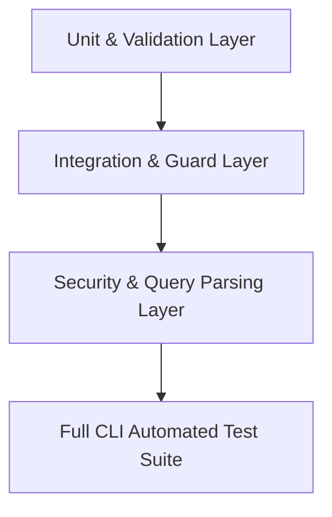

# Automated Testing Plan (Practical 9)

**Course:** Advanced Web Technology (AWT)  
**Project:** Orion DB (Fullstack Cloud Database Console & API Engine)  
**Document Version:** 1.0  
**Scope:** CLI-Based Automated Test Execution & Quality Assurance  

---

## 1. Objectives & Scope

The objective of Practical 9 is to implement, execute, and document a rigorous, command-line-driven automated testing suite for the Orion DB platform. The testing effort focuses on critical core systems:
1. **Authentication & Authorization Subsystems**: Login, registration, credential validation, and JWT cookie lifecycle.
2. **Security Guards & Middleware**: Protection of API endpoints via `JwtAuthGuard` and `ProjectKeyGuard`.
3. **Data Integrity & SQL Injection Defense**: Robust sanitization in `query-parser` and `sql-editor`.
4. **Client-Side Validation & Cookie Persistence**: Next.js Zod schemas and cookie parsing utilities.

---

## 2. Testing Strategy & Pyramid

Our automated testing strategy incorporates multiple levels of verification:



### 2.1 Test Levels
1. **Unit Testing**: Tests individual functions, DTO validation rules, and schema parsers in isolation with zero external I/O.
2. **Integration / Guard Testing**: Validates NestJS execution contexts, request interceptors, and JWT verification flows.
3. **Security Testing**: Executes negative injection vectors against SQL identifier validators and multi-statement blockers.
4. **Client Schema Validation**: Tests Next.js form schemas to ensure invalid inputs are blocked before dispatching network requests.

---

## 3. Technology Stack & Frameworks

| Subsystem | Framework / Runner | Assertion Library | Coverage Engine |
|---|---|---|---|
| **Backend (`apps/api`)** | Jest 30.0.0 | Jest `expect` / `@nestjs/testing` | Istanbul / V8 |
| **Frontend (`apps/web`)** | Vitest 5.0.5 | Vitest `expect` / JSDOM | `@vitest/coverage-v8` |
| **Package Manager** | `pnpm` (Workspace Monorepo) | N/A | N/A |
| **Runtime Environment** | Node.js v24.x (Windows x64) | N/A | N/A |

---

## 4. Safety & Database Isolation Architecture

> [!IMPORTANT]
> **Zero Destructive Impact Guarantee:**  
> In accordance with project safety guidelines, automated tests **NEVER** execute destructive operations (`DROP`, `TRUNCATE`, `DELETE`) against the production Neon PostgreSQL database.

* **Mock Services**: `DrizzleService` queries and database operations are mocked using `@nestjs/testing` mock providers.
* **Hermetic Execution**: Unit and integration test suites run entirely in-memory with deterministic inputs and outputs.
* **Secret Protection**: All JWT secrets and configuration values are injected via mock `ConfigService` instances, avoiding any credential exposure.

---

## 5. Pass/Fail Decision Criteria

A test is classified as **PASS** if and only if the system produces the expected behavior defined by the API contract:
* **Positive Scenarios**: Valid inputs succeed with expected status codes (e.g., HTTP 200 OK) and generate correct tokens/payloads.
* **Negative Scenarios**: Invalid or malicious inputs are correctly intercepted and rejected with appropriate error status codes (e.g., HTTP 400 Bad Request, HTTP 401 Unauthorized, HTTP 409 Conflict) and descriptive error messages.
* **Failure Condition**: Any unhandled exception, incorrect status code, or unfulfilled assertion immediately marks the test as **FAIL**.

---

## 6. Execution Commands & Reporting

```bash
# Execute Backend Test Suite
pnpm --filter api test

# Execute Backend with Terminal Coverage
pnpm --filter api test:cov

# Execute Frontend Test Suite
pnpm --filter web test

# Execute Frontend with Terminal Coverage
pnpm --filter web test:cov
```

All test outcomes are formatted directly in the terminal showing:
`STATUS | TEST ID | TEST NAME | INPUT / SCENARIO | EXPECTED OUTCOME | ACTUAL OUTCOME`
